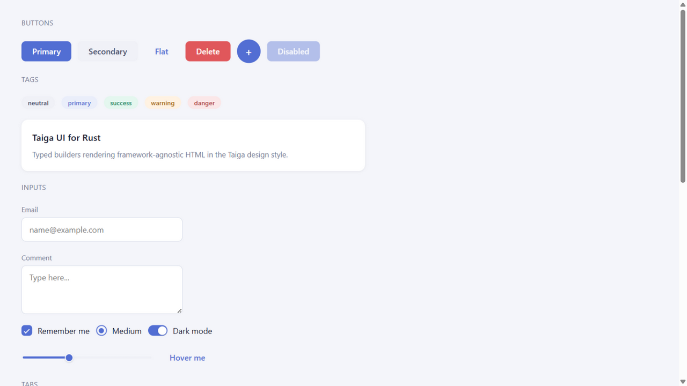

# taigaui

Taiga UI design components for Rust: typed builders that render styled, framework-agnostic HTML.

No JS runtime, no framework lock-in. Works with axum, actix-web, rocket, static site generators, or plain string output. Checkboxes, radios, toggles, sliders and text fields are real `<input>` elements and stay interactive without JavaScript.

**Siblings in the family** — same builder API, different design systems: [matui](https://crates.io/crates/matui) (Material Design 3) and [bootstyle](https://crates.io/crates/bootstyle) (Bootstrap 5).



*(Full-page gallery: [gallery-full.png](https://raw.githubusercontent.com/StarcevAlexander/taigaui/main/docs/screenshots/gallery-full.png))*

## Interactive demo

Run the bundled gallery example and open the generated file in a browser:

```bash
cargo run --example basic > gallery.html
```

The `main` branch of the repository also serves this gallery via GitHub Pages: https://starcevalexander.github.io/taigaui/

## Components

| Category | Components |
|---|---|
| Actions | `Button` (Primary/Secondary/Flat/Danger, round) |
| Display | `Tag` (Neutral/Primary/Success/Warning/Danger), `Card`, `Badge`-style tags |
| Input | `Input`, `Textarea`, `Checkbox`, `Radio`, `Toggle`, `Slider` |
| Navigation | `Tabs` |
| Feedback | `Alert` (Neutral/Success/Warning/Danger), `ProgressBar`, `ProgressRing`, `Tooltip`, `Accordion` |

Every component implements `Render`, returning an HTML string. All classes share the `tui-` prefix, and design tokens are exposed as CSS custom properties (`--tui-primary`, `--tui-surface`, ...) matching the Taiga UI palette.

## License

Licensed under either of MIT or Apache-2.0, at your option.

Not affiliated with the Taiga UI team. Taiga UI is an Angular UI kit by taiga-family, released under Apache-2.0; this crate only provides Rust builders that emit HTML and CSS in a similar visual style.
